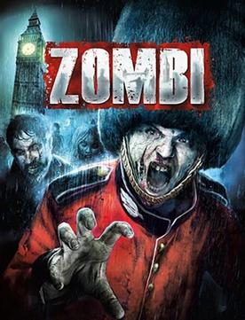
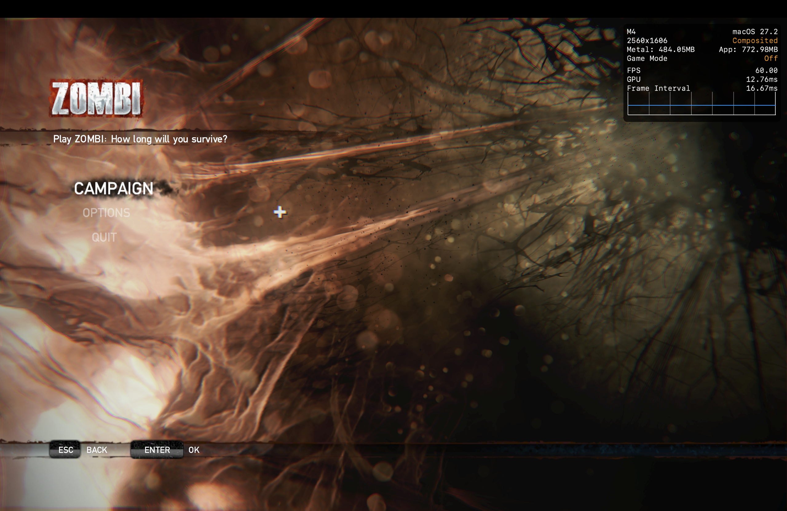
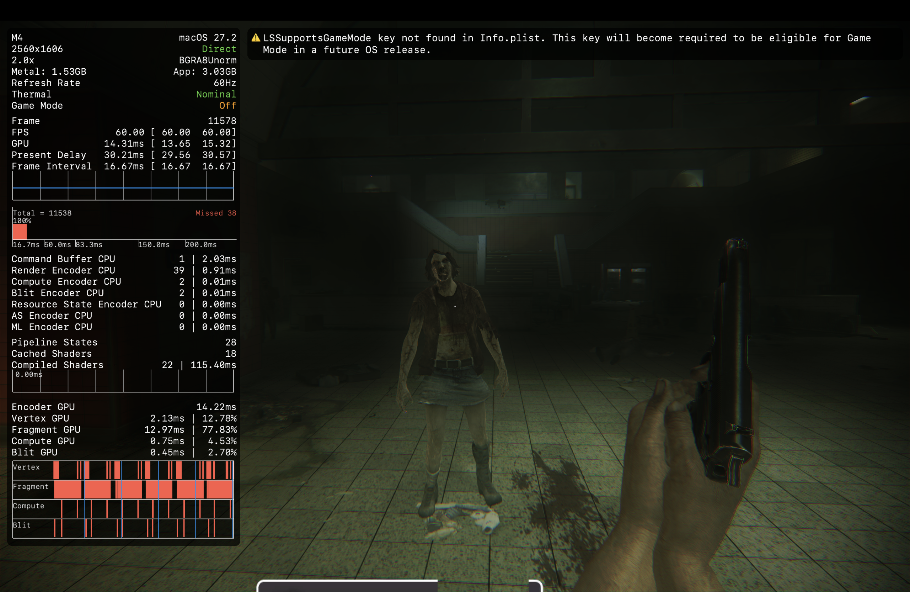

( Apologies for the shitty writing your about to bestow your eyes upon. A lot of this was partially written during late nights, I'll get around to cleaning it up, and also the incessant ramblings)

This will also get fairly technical, if you just want to see the cool shit + notes scroll to the bottom.

## Intro

ZombiU is a survival horror game released in 2012 as a launch title for the WiiU. The economic disaster that was the WiiU is something we can talk about in another blog post, but for now, I want to focus on ZombiU.

It was... quite a departure from what Ubisoft was known for making back then.
Set in post-apocalyptic London in 2012, you assume control of a survivor caught in the middle of the "Blight", an infection that turns your average British citizen into a drooling bastard with a hunger for your neck flesh. You must survive the drooling dead while following the instructions of "The Prepper", a mysterious man whose goal is to keep you alive for as long as possible.

One of ZombiU's flagship features was its **Rebirth system**. If you died, you wouldn't simply respawn at a checkpoint. Instead, you'd return as an entirely different survivor (well, the first three aren't random), complete with a randomized name, gender, age, and profession (which all don't really matter but its still a really nice touch and adds atmosphere.) You'd then have to backtrack to where you died and, depending on whether your previous survivor was infected, kill them and recover your belongings.

The game was generally well-received, particularly for its use of the Wii U GamePad. You could use it to manage your inventory, read notes, scan your surroundings, and perform various other actions. Doing so would leave your character vulnerable on the TV, forcing you to constantly divide your attention between two screens. On the other hand, the game was criticized for its repetitive melee combat and somewhat lackluster story, but I digress.

Anyways, in the year of our lord 2015, Ubisoft and Straight Right hugged, kissed, and partnered up to port the game to other platforms. Considering that ZombiU had been exclusive to a console which was absolutely fucking demolished by the XBOne and PS4, seemed like a good decision
Unfortunately, the ports were... hot ass.

The GamePad mechanics were effectively gutted, with everything being condensed onto a single screen. The multiplayer mode was also removed, and a plethora of bugs were introduced. On the bright side, they added two additional melee weapons, compared to the single cricket bat available in the original WiiU version, which is nice. And while the WiiU version was praised for its unique mechanics, the ports (particularly the PC release) became notorious for their bugs, glitches, and the demon fuckspawn that is the Ubisoft Launcher.

Ubisoft managed to fuck things up even further during the transition from Uplay to Ubisoft Connect (which caused an issue where you couldn't even launch the damn game.) They eventually released a haphazard patch for the PC version that fixed some of the launcher related headaches, meaning you could finally play the game without shutting off your wifi. Unfortunately, this update also broke the game's sound-cache system, meaning some sounds wouldn't play for some fucking reason.

## Where That Brings Us Now

ZombiU has always fascinated me, particularly because of the technology behind it.
The game runs on Ubisoft's **LyN engine**, which evolved from their previous engine, Jade. Unlike LyN, Jade has some documentation (and an entire leaked source repository), making it a useful starting point for understanding LyN.

Anyways, a few months ago, I decided I wanted to attempt a decompilation of ZOMBI.
I wasn't going in completely blind. I'd already spent some time researching the game's file formats and had previously written an [archive manager + blender plugin written in Python](https://github.com/flarglefingler/ZOMBI-Manager), which was capable of opening and extracting the game's `.bfz` files.

Eventually, I decided to take a closer look at the executable itself.

And, to my surprise, Ubisoft had left behind some pretty interesting stuff.

## Scratching the Surface

### The Engine and Game DLL

The game's executable is `ZOMBI.exe`. It's what you launch to actually play the game (duh).

What many people might not know, however, is that LyN works a little differently from what you'd expect. In some ways, it reminds me of the Source Engine.
With Source, games such as Half-Life 2 and Counter-Strike: Source can share the same executable, `hl2.exe`. The `-game` command-line argument tells the engine which game's directory and configuration to load.
LyN follows a somewhat similar principle, although its implementation is different, which I'll talk about in a sec.

**`ZOMBI.exe` is essentially the engine itself.**

Rather than containing all of the game's logic in one executable, LyN separates much of the game-specific code into another binary. In ZOMBI's case, the executable uses a command-line argument to identify the game DLL it needs to load.

That DLL is called `Rabbids.win32.f.dll`. On other platforms its named similar, such as `Rabbids.orbis.f.prx` on PS4.

(Slight note, ZombiU refers to a lot of things as Rabbids, this is a leftover from its previous iteration, Killer Rabbids from Outer Space)
### Ubisoft's AI System

When developing games using Jade or LyN, Ubisoft would frequently fork and modify the engine for individual projects, adding whatever functionality they needed. You can find evidence of this in various games, including assert strings and debugging information left behind in titles such as Just Dance 4, which DID actually ship with debug symbols.

But the actual game-specific logic was handled somewhat differently.
Ubisoft used its own proprietary scripting system, referred to internally as **AI** (not to be confused with Artificial Intelligence). Parts of this technology have surfaced in games such as Rabbids Go Home. They also used some third party stuff (such as BINK for Cinematics, a forked version of Recast for nav meshes, FIRe (which is just Flash) used for UI, etc.)

Instead of interpreting all of this logic at runtime, Ubisoft could convert the AI code into C++ (using an internal tool only called `AI2Cpp`.)
The resulting C++ code would then be compiled into the game's DLL, which the engine loads at runtime.

In other words, a significant portion of the game's actual behavior lives inside `Rabbids.win32.f.dll`, while `ZOMBI.exe` handles much of the underlying engine functionality.

Ever noticed a file named `AiFunctionsMapping.txt` in the game's directory? Well, it isn't just some random leftover.
The file contains mappings between identifiers and engine-exposed functions. These mappings are part of the interface that allows the game-specific code to communicate with the engine. Understanding this was quite nice (and helped a lot in decompilation)

### Compiler Optimizations (or Lack Thereof)

There was another interesting discovery hiding inside the executable.
**Large portions of ZOMBI's executable appear to have been compiled with little to no optimization.**

For anyone unfamiliar with reverse engineering, this is a pretty big deal.
When decompiling a game, one of the best things you can possibly have is access to its debug symbols.
On Windows, these are commonly stored in `.pdb` files, which can contain function names, type information, source-file references, and other debugging metadata.

Having the original PDBs can turn an otherwise miserable reverse-engineering project into something considerably more manageable.
Unfortunately, ZOMBI didn't ship with them. Ubisoft was smart enough to keep those to themselves.

But there's another factor that can make decompilation easier: **compiler optimizations**.
Normally, when compiling a program, the compiler can perform various transformations to make the resulting machine code faster or smaller. Functions might get inlined, loops might be rearranged, variables might disappear entirely, and the final assembly can end up looking almost nothing like the original source code.

For reverse engineering, this can be an absolute nightmare.
An unoptimized build, however, tends to preserve much more of the original program's structure. Functions are often easier to identify, control flow is more straightforward, and reconstructing the original logic becomes considerably less painful.

And in ZOMBI's case, much of the executable is surprisingly friendly in that regard.
That's not to say decompiling it is suddenly effortless. There's still a ton of work involved, especially without debug symbols.
But compared to a heavily optimized release build, I'll gladly take what Ubisoft gave us.

### A Shader Goldmine

Ubisoft also left behind something else that was incredibly useful. And to explain why, we need to talk briefly about 3D rendering.

Modern rendering pipelines make extensive use of **shaders**, small programs executed on the GPU that control various stages of rendering. They're responsible for things like transforming vertices, calculating lighting, sampling textures, and producing the final appearance of rendered surfaces.

Normally, games ship with shaders that have already been compiled into a format suitable for their target graphics API or hardware.
This avoids having to compile everything from scratch during gameplay, which can introduce loading delays or stuttering.
ZOMBI is no exception. In the game's directory, you'll find a `Cache` folder containing precompiled shader data used by DirectX 9, nothing unusual there.

However, Ubisoft made one rather glorious mistake.
**They also shipped the original, uncompiled shader source files.**
This was a mistake, none of the game (the executable or the gamecode) references it, they also did the same screw up on the Japanese Demo of ZombiU.

For someone trying to reconstruct the rendering pipeline, this is an absolute goldmine. As instead of trying to painstakingly recreate how the game looked like, it was instead handed to us. We can use it and adapt it to other graphics APIs.
It doesn't magically reverse engineer the entire renderer, but it eliminates a significant amount of guesswork. Thanks, Ubisoft!

## Pulling the Trigger

With all of this information gathered, I finally decided to go ahead with the project.
Recently, there's been an absolutely monstrous increase in AI-assisted decompilation and recompilation projects.
I'm not going to open that particular can of worms here. (I'm not particularly fond of either approach, especially the latter), but I figured there was an opportunity to make use of these tools for something I actually cared about.

So, I decided to shill out a "few bucks" and bought Claude's highest coding tier.

My original plan was fairly straightforward (although shitty):

I'd handle the engine-related work myself, focusing primarily on `ZOMBI.exe`, 
while using Claude to help reconstruct the game-specific code inside `Rabbids.win32.f.dll`.

The reasoning was simple: unlike the executable, the game DLL was optimized (and it was hard as fuck even trying to crack it, so I gave up)
Rather than spend an eternity manually untangling the entire thing, I wanted to see how much of the process could be accelerated while still keeping the resulting code understandable and maintainable.

With all that bullshit out of the way, we ready:

## Introducing... zombi-decomp

Introducing **zombi-decomp**, my attempt to reconstruct the latest Steam release of ZOMBI.
Progress has actually been quite decent. I already have a sizable chunk of the engine + game code already tacked down. I got the physics engine implemented, navigation (like I said earlier, it was just a heavily forked version of Recast, which is open source), I even got UI (UI is done via FIRe, and its essentially just Flash, I forked portions of Ruffle and got it to work). I also got the games proprietary script format also mostly implemented (which is used for some misc mission related things, and also responsible for the laser that Sondra's sniper rifle uses)

Claude's assistance has been pretty nice, It converted the original shaders to MSL, which allowed them to work with Apple's Metal graphics API (which is the renderer on macOS and iOS that most things use). While I was at it, I chose some dependencies that would alleviate any future work that would get this running on any platforms besides macOS, that is:

- **SDL3** for window management and input.
- **FFmpeg**, using a slimmed-down version for BINK support.
- **Metal** as the initial rendering backend for macOS, with room for other backends in the future.
- 
### What Kind of Decompilation Is This?

Currently, I'd estimate that **roughly 50% of the game has been decompiled or reconstructed**.
I want to really quick stress that this project is **not intended to be a byte-for-byte decompilation.**

In traditional matching decompilation projects, the goal is often to reconstruct source code that, when compiled with the original toolchain, produces machine code identical (or as close as possible) to the original binary. That's not what I'm aiming for (mainly because we'd be here forever)

Instead, my goal is a **functionally accurate reconstruction**. Pretty much as long as the resulting code behaves like the original game I'm happy. I don't really care honestly whether a function has the exact same structure or assembly output as the original, but rather at least it working identically as it should in the retail game, and later down the line I can start to fix some of the fuckups Ubi left behind along the way.

### Some Screenshots

Here's the game running so far:

There's still plenty of work left to do, but progress has been going nicely. Once decompilation is "finished", I plan to put all my current work in a branch simply titled "pc", and then start a new main branch called "enhanced" which I'll put a plethora of bug fixes, features, and more.
If everything continues at the current pace, I'm hoping to have the full game playable within the next month or so. Until then, the repo will stay private for a bit, but shit can change, so who knows 🤷. Stay tuned for more.
